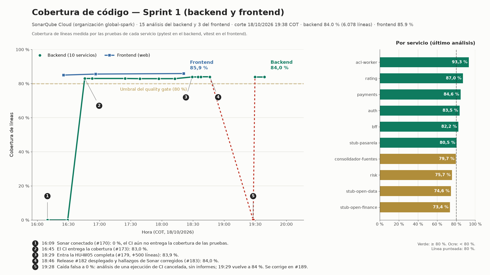

# Cobertura de código del Sprint 1 — metodología y trazabilidad

Fuente: **SonarQube Cloud**, organización `global-spark`, proyectos `global-spark_solventa-backend` y
`global-spark_solventa-frontend`. Nada de lo que sigue es inventado para el gráfico: los puntos son los análisis reales
que Sonar guardó (uno por cada merge a `develop`), leídos por su API el 2026-10-18 a las 19:40 hora de Bogotá (COT).

## Qué mide

- **Cobertura de líneas** que reporta Sonar (`coverage`), a partir de los informes de las pruebas unitarias.
  **Backend:** `pytest --cov=app` en cada uno de los 10 servicios (job `cobertura` de `ci.yml`, solo en los push a `develop`
  y `main`); `sonar.coverage.exclusions=**/migrations/**` deja fuera las migraciones, que se prueban contra el almacén real
  en el job `migraciones`. **Frontend:** `vitest run --coverage` (lcov).
- Las pruebas no cuentan como código a cubrir (`sonar.exclusions=**/tests/**`).
- El umbral de 80 % del gráfico es el del *quality gate* de Sonar («Sonar way»), que se aplica al **código nuevo**, no al
  total; se dibuja como referencia.

## Cómo se obtuvo

| Dato | Llamada a la API de Sonar |
|---|---|
| Evolución | `GET /api/measures/search_history?component=<proyecto>&metrics=coverage,ncloc` |
| Commit de cada análisis | `GET /api/project_analyses/search?project=<proyecto>` (campo `revision`), cruzado con el PR de cada merge en `git log` |
| Por servicio | `GET /api/measures/component_tree?component=<proyecto>&metricKeys=coverage,ncloc&strategy=all&qualifiers=DIR` |

Las horas se pasan de UTC a COT (UTC−5). El historial empieza el 18/10 a las 16:09 COT porque Sonar se conectó ese día
(#170): antes no se medía la cobertura, así que no hay puntos de días anteriores.

## Los 5 hitos del gráfico

1. **16:09** — Sonar conectado (#170): 0 %. El CI todavía no entregaba los informes de cobertura.
2. **16:45** — #173 hace que el CI entregue la cobertura de las pruebas: **83,0 %**.
3. **18:29** — Entra la HU-W05 completa (#179, unas 500 líneas de código nuevo): **83,9 %**.
4. **18:46** — Release #182 desplegado y hallazgos de Sonar corregidos (#183): **84,0 %**.
5. **19:28** — Caída **falsa** a 0 %, y a las 19:29 vuelve a 84 %.

### La caída del hito 5 (no es una pérdida real de cobertura)

Se mezclaron tres PRs a `develop` en 41 segundos (#187, #188 y #185). El CI cancela la ejecución anterior cuando llega un
push nuevo (`cancel-in-progress`) y, con ella, sus jobs de `cobertura`; pero el job `sonar` tenía `if: always()`, que corre
aunque el workflow se cancele, y analizó sin informes: publicó 0 %. La ejecución completa del último push lo dejó otra vez
en 84 %. El #189 hace que `sonar` solo corra si `cobertura` terminó bien. El punto se deja en el gráfico, marcado en rojo,
en lugar de borrarlo.

## Backend: 15 análisis

| Hora (COT) | Commit | PR | Cobertura | Líneas de código | Nota |
|---|---|---|---|---|---|
| 16:09 | `a233ab8` | #170 | 0,0 % | 5.590 | sin informes: el CI aún no entregaba la cobertura |
| 16:29 | `837af06` | #171 | 0,0 % | 5.587 | sin informes: el CI aún no entregaba la cobertura |
| 16:45 | `903a0e6` | #173 | 83,0 % | 5.587 |  |
| 16:52 | `6417bb0` | #172 | 83,0 % | 5.591 |  |
| 17:24 | `6b74070` | #174 | 83,0 % | 5.591 |  |
| 17:38 | `b5bbd7e` | #175 | 82,9 % | 5.583 |  |
| 17:57 | `f4342fa` | #176 | 82,9 % | 5.583 |  |
| 18:12 | `ad2b416` | #178 | 82,9 % | 5.583 |  |
| 18:29 | `f606e78` | #179 | 83,9 % | 6.074 |  |
| 18:35 | `3c73f4c` | #181 | 83,9 % | 6.074 |  |
| 18:37 | `6186556` | #180 | 84,0 % | 6.080 |  |
| 18:46 | `44872dd` | #183 | 84,0 % | 6.078 |  |
| 19:28 | `fae8122` | #187 | 0,0 % | 6.078 | **falso:** ejecución de CI cancelada, sin informes |
| 19:29 | `0d13999` | #185 | 84,0 % | 6.078 |  |
| 19:38 | `25edc4c` | #189 | 84,0 % | 6.078 |  |

## Frontend: 3 análisis

| Hora (COT) | Cobertura | Líneas de código |
|---|---|---|
| 16:25 | 85,0 % | 2.644 |
| 16:56 | 85,6 % | 2.746 |
| 18:21 | 85,9 % | 2.772 |

## Backend por servicio (último análisis)

| Servicio | Cobertura | Líneas de código |
|---|---|---|
| `acl-worker` | 93,3 % | 1.048 |
| `rating` | 87,0 % | 558 |
| `payments` | 84,6 % | 1.218 |
| `auth` | 83,5 % | 933 |
| `bff` | 82,2 % | 1.140 |
| `stub-pasarela` | 80,5 % | 238 |
| `consolidador-fuentes` | 79,7 % | 304 |
| `risk` | 75,7 % | 323 |
| `stub-open-data` | 74,6 % | 159 |
| `stub-open-finance` | 73,4 % | 157 |

Por debajo del 80 % están los 3 stubs, `risk` y `consolidador-fuentes`.

## Límites

- Un solo día de historial (el 18/10): sirve para mostrar el nivel alcanzado y su estabilidad, no una tendencia de varios días.
- Es cobertura de líneas por pruebas unitarias; no mide ramas (`pytest-cov` sin `--cov-branch`) ni las pruebas de punta a punta
  (Newman, el humo, `scripts/probar_cobros.py`) ni los k6.
