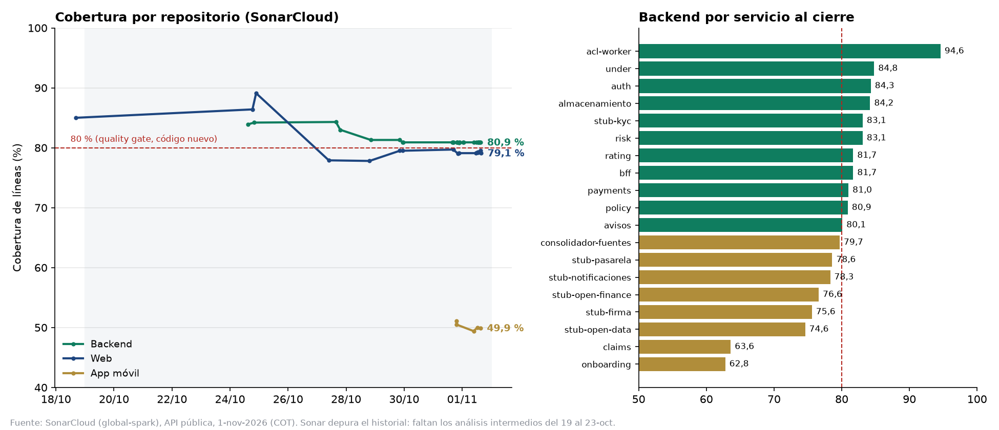

# Cobertura de código del Sprint 2 — metodología y trazabilidad

Fuente: **SonarQube Cloud**, organización `global-spark`, proyectos `global-spark_solventa-backend`,
`global-spark_solventa-frontend` (web) y `global-spark_solventa-mobile` (app). Leído por su API pública el 2026-11-01 a las
16:00 hora de Colombia (COT). Nada es inventado para el gráfico: son los análisis que Sonar guardó, uno por cada push
analizado.

## Resultado al cierre (1/11, 15:42 COT)

| Repositorio | Cobertura | Líneas de código | Al cierre del Sprint 1 (18/10) | Umbral 80 % |
|---|---|---|---|---|
| Backend | **80,9 %** | 34.196 | 84,0 % con 6.080 líneas | Lo cumple |
| Web | **79,1 %** | 16.901 | 85,0 % con 2.644 líneas | Queda 0,9 puntos por debajo |
| App móvil | **49,9 %** | 20.357 | Sin Sonar (se conectó el 31/10) | Por debajo |

El backend se multiplicó por 5,6 en líneas y la web por 6,4, y la cobertura bajó 3,1 y 5,9 puntos. El umbral de 80 % del
gráfico es el del *quality gate* de Sonar («Sonar way»), que se aplica al **código nuevo** de cada PR, no al total; se dibuja
como referencia.

## Qué mide

- **Cobertura de líneas** que reporta Sonar (`coverage`), a partir de los informes de las pruebas unitarias. **Backend:**
  `pytest --cov=app` por servicio (job `cobertura` de `ci.yml`, en los push a `develop` y `main`); se excluyen migraciones y
  pruebas. **Web:** `vitest run --coverage` (lcov). **App móvil:** `flutter test --coverage` (lcov) en el devcontainer.
- No incluye las pruebas de punta a punta (Newman, Cypress, `integration_test`) ni las de carga (k6).

## Cómo se obtuvo

| Dato | Llamada a la API de Sonar |
|---|---|
| Evolución | `GET /api/measures/search_history?component=<proyecto>&metrics=coverage,ncloc` |
| Por servicio (backend) | `GET /api/measures/component_tree?component=global-spark_solventa-backend:<services\|stubs>&metricKeys=coverage,ncloc&strategy=children` |

**Faltan los análisis del 19 al 23/10.** Sonar depura el historial (*housekeeping*) y solo conserva algunos análisis por
periodo: del Sprint 1 quedó el primero (18/10 16:09, 0 % porque el CI aún no entregaba informes; ver `cobertura-sprint-1.md`)
y del Sprint 2 los posteriores al 24/10. Ese punto en 0 % se omite en la línea, porque no es una medición de cobertura.

## Backend por servicio al cierre

| Servicio | Cobertura | Líneas |
|---|---|---|
| acl-worker | 94,6 % | 2.787 |
| under | 84,8 % | 352 |
| auth | 84,3 % | 2.669 |
| almacenamiento | 84,2 % | 1.240 |
| stub-kyc | 83,1 % | 306 |
| risk | 83,1 % | 2.498 |
| rating | 81,7 % | 2.007 |
| bff | 81,7 % | 8.900 |
| payments | 81,0 % | 2.258 |
| policy | 80,9 % | 4.552 |
| avisos | 80,1 % | 255 |
| consolidador-fuentes | 79,7 % | 304 |
| stub-pasarela | 78,6 % | 965 |
| stub-notificaciones | 78,3 % | 209 |
| stub-open-finance | 76,6 % | 228 |
| stub-firma | 75,6 % | 213 |
| stub-open-data | 74,6 % | 159 |
| claims | **63,6 %** | 2.799 |
| onboarding | **62,8 %** | 1.495 |

Los dos servicios nuevos del sprint más bajos son `claims` (HU-W04) y `onboarding` (HU-M01): juntos tienen 4.294 líneas y
son los que bajan el promedio. Subirlos a 80 % es la acción concreta para el Sprint 3, junto con la app móvil.

## Evolución (análisis conservados por Sonar, COT)

| Fecha | Backend | Líneas | | Fecha | Web | Líneas |
|---|---|---|---|---|---|---|
| 24/10 14:40 | 83,9 % | 14.482 | | 24/10 18:32 | 86,4 % | 5.107 |
| 24/10 20:00 | 84,2 % | 16.495 | | 24/10 21:34 | 89,1 % | 6.735 |
| 27/10 15:34 | 84,3 % | 18.190 | | 27/10 09:43 | 77,9 % | 10.440 |
| 27/10 19:08 | 83,0 % | 20.158 | | 28/10 19:23 | 77,8 % | 10.455 |
| 28/10 20:26 | 81,3 % | 28.566 | | 29/10 20:25 | 79,5 % | 16.085 |
| 29/10 22:46 | 80,9 % | 32.905 | | 31/10 16:35 | 79,7 % | 16.152 |
| 31/10 21:14 | 80,8 % | 33.430 | | 31/10 20:36 | 79,0 % | 16.387 |
| 01/11 15:23 | 80,9 % | 34.196 | | 01/11 15:42 | 79,1 % | 16.901 |

El backend tiene 28 análisis en el sprint; la tabla muestra los que cambian la cifra o las líneas de forma notable (todos los
del 29/10 al 1/11 están entre 80,8 % y 80,9 %). Las caídas coinciden con la entrada de código grande: el 28/10 en el backend
(HU-W04: `claims`, la orden de pago en PAYMENTS y la mesa de siniestros en el BFF, +8.400 líneas) y el 27/10 en la web
(HU-W03 con mocks, +3.700 líneas).

App móvil: 51,1 % (31/10 19:10, 13.855 líneas) → 50,5 % → 49,4 % → 50,0 % → **49,9 %** (1/11 15:10, 20.357 líneas).

## Cómo se generó la imagen

`matplotlib` (Python), script ad hoc de la sesión (no versionado), con los datos de las tablas de este archivo.
