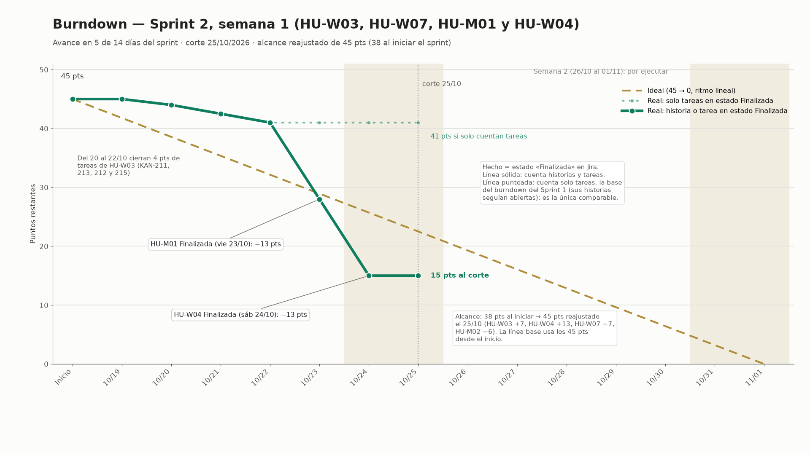
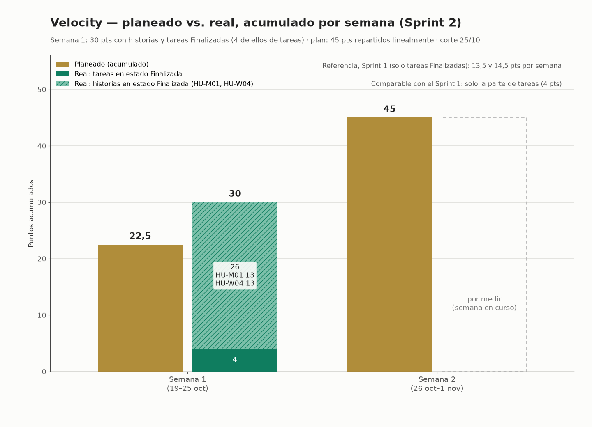
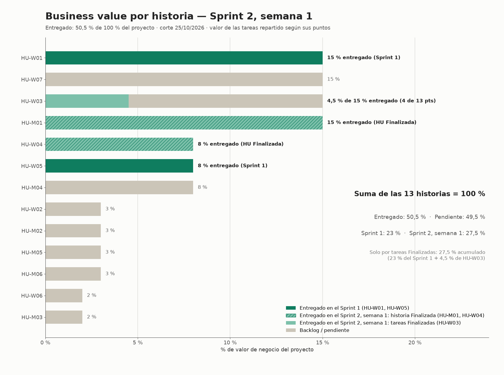

# Métricas del Sprint 2, semana 1 — metodología y trazabilidad

Evidencia de avance semanal: **burndown**, **velocity** y **value**. Semana 1 = lunes 19 a domingo 25 de octubre de 2026
(el Sprint 2 corre del 19 de octubre al 1 de noviembre; en Jira es `KAN Sprint 2`, id 35). Corte: **2026-10-25**.

Fuente: tablero Jira **KAN**, leído vía API (MCP Atlassian Rovo) el 2026-10-25 por la tarde: puntos (`customfield_10076`),
valor de negocio por historia (`customfield_10111`) y por tarea (`customfield_10112`), estado, fecha de resolución y worklogs de
cada incidencia. Los números no son inventados para el gráfico. Daniel y Jhoan seguían editando Jira ese día: si el tablero
cambia, los números también.

## Alcance del sprint

| Historia | Jira | Puntos | Tareas | Estado en Jira (25/10) |
|---|---|---|---|---|
| HU-W03 | KAN-26 | 13 | KAN-209 a 216 (6 pts), KAN-240 (4) y KAN-241 (3) | En curso: 4 pts finalizados (KAN-211, 212, 213, 215) |
| HU-W07 | KAN-30 | 6 | KAN-217 a 224 | Tareas por hacer (arranca en la 2.ª semana) |
| HU-M01 | KAN-31 | 13 | KAN-231 a 238 | **Finalizada** (25/10), con sus 8 tareas sin cerrar |
| HU-W04 | KAN-27 | 13 | KAN-242 a 249 | **Finalizada** (25/10), con sus tareas En curso o por hacer |
| **Total** | | **45** | | |

Al iniciar el sprint Jira tenía **38 pts** (HU-W03 6 + HU-W07 13 + HU-M01 13 + HU-M02 6). El 25/10 el equipo reajustó: HU-W03
+7, HU-W04 +13, HU-W07 −7 y HU-M02 −6 (pasa al Sprint 3), para **45 pts** (ver `release-burndown.md`). La línea base de las tres
gráficas es la de 45 pts desde el inicio; no se dibuja un escalón de alcance el 25/10 porque HU-W04 ya tenía trabajo el 22/10.

## Criterio de «hecho» (la decisión que más pesa)

**Hecho = estado «Finalizada» en Jira.** En el Sprint 1 el burndown contó solo **tareas** Finalizadas, porque las historias seguían
«Tareas por hacer» y no había otra señal. En el Sprint 2, HU-M01 y HU-W04 se cerraron como **historia** el 25/10 (13:23 y 13:24), con
sus tareas abiertas y el tiempo registrado sobre la historia. Por eso cada gráfica muestra dos lecturas, nombradas por lo que cuentan:

- **Lectura A, historias y tareas Finalizadas:** cuenta como hecho lo que Jira marca «Finalizada», sea la historia (y entonces todas
  sus tareas) o la tarea. Fecha de cierre = fecha del último worklog (`started`), no la de resolución, porque las resoluciones son del
  24 y 25/10 y reflejarían el cierre administrativo y no cuándo se trabajó, igual que en el Sprint 1.
- **Lectura B, solo tareas Finalizadas:** es la base del burndown, la velocity y el value del Sprint 1, y por eso **la única que se
  compara con ellos**. La lectura A tiene otra base y no es comparable con las cifras del Sprint 1.

La diferencia entre A y B no la produce el gráfico sino el tablero: desaparece cuando se cierran las tareas de HU-M01 y HU-W04, y
entonces queda una sola línea.

| | Lectura A: historias y tareas | Lectura B: solo tareas |
|---|---|---|
| Puntos cerrados en la semana 1 | **30** (4 de tareas + 26 de historias) | **4** |
| Puntos que faltan al corte | **15** | **41** |
| Valor de negocio entregado (acumulado) | **50,5 %** | **27,5 %** |

## Burndown (`burndown-sprint-2-semana-1.png`)

Puntos restantes al cierre de cada día. Línea ideal: 45 → 0 en línea recta entre el inicio y el 1 de noviembre.

| Fecha | Cerrado ese día (pts) | Restante, lectura A (historias y tareas) | Restante, lectura B (solo tareas) |
|---|---|---|---|
| Inicio | — | 45 | 45 |
| 10/19 | 0 | 45 | 45 |
| 10/20 | 1 (KAN-211) | 44 | 44 |
| 10/21 | 1,5 (KAN-213) | 42,5 | 42,5 |
| 10/22 | 1,5 (KAN-212 y KAN-215) | 41 | 41 |
| 10/23 | 13 (HU-M01, historia Finalizada) | 28 | 41 |
| 10/24 | 13 (HU-W04, historia Finalizada) | 15 | 41 |
| 10/25 | 0 | 15 | 41 |

Hay avance en 5 de los 14 días del sprint (sin avance: lunes 19 y domingo 25; los siete días del 26/10 al 1/11 aún no ocurren).
Los fines de semana van sombreados.

## Velocity (`velocity-sprint-2-semana-1.png`)

Acumulado por semana, con el plan repartido de forma lineal sobre los 45 pts (22,5 por semana), como en el Sprint 1.

| Semana | Planeado (acum.) | Real (acum.) | Real de la semana |
|---|---|---|---|
| 1 (19–25 oct) | 22,5 | **30** en la lectura A (4 de tareas + 26 de historias) · **4** en la lectura B | 30 (A) · 4 (B) |
| 2 (26 oct–1 nov) | 45 | por medir | — |

Referencia del Sprint 1: 13,5 y 14,5 pts por semana (28 con los 2 pts agregados), contando solo tareas Finalizadas. **Con esa misma
base, la semana 1 del Sprint 2 rinde 4 pts**; los 30 pts de la lectura A no son comparables con las cifras del Sprint 1, y 26 de ellos
salen de dos historias cerradas el mismo día, no de tareas cerradas poco a poco. Esta comparación no es un juicio sobre el trabajo:
refleja que las tareas de HU-M01 y HU-W04 siguen abiertas en Jira.

## Business value (`value-sprint-2-semana-1.png`)

Valor de negocio por historia, con la suma de las 13 historias del backlog en 100 %.

| Historia | Valor | Entregado | Cómo se cuenta |
|---|---|---|---|
| HU-W01 | 15 % | 15 % | Sprint 1 |
| HU-W05 | 8 % | 8 % | Sprint 1 |
| HU-M01 | 15 % | 15 % | Historia Finalizada el 25/10 |
| HU-W04 | 8 % | 8 % | Historia Finalizada el 25/10 |
| HU-W03 | 15 % | 4,5 % | 4 de sus 13 pts: KAN-211 (1,1 %), KAN-212 (1,1 %), KAN-213 (1,7 %), KAN-215 (0,6 %) |
| Las otras 8 | 36 % | 0 % | Pendiente |
| **Total** | **100 %** | **50,5 %** | Sprint 1: 23 % · Sprint 2, semana 1: 27,5 % · pendiente: 49,5 % |

El valor de cada tarea es el de su historia repartido según sus puntos (`valor_tarea = valor_HU / puntos_HU × puntos_tarea`).

## Salvedades

- **Las fechas de trabajo de las 4 tareas de HU-W03 son declaradas.** Los worklogs de KAN-211, 212, 213 y 215 (25 h en total) los
  repartió Frans del 20 al 22/10 antes de sus commits del 22/10 por la noche; cada comentario lo dice. Jira resolvió esas tareas el
  24/10 (entre las 11:55 y las 16:18). Con la fecha de resolución, los 4 pts caerían el sábado 24/10 y la lectura A
  terminaría igual en 15.
- **Las fechas de cierre de HU-M01 y HU-W04** son las del último worklog que registraron sus responsables (viernes 23/10 y
  sábado 24/10), no la fecha de resolución (25/10).
- **Los bloques de tiempo de Daniel (31 h el sábado) y de Jhoan (24 h el viernes) están registrados sobre la historia**, no sobre
  sus tareas, por lo que las gráficas de horas por día mostrarían picos. Estas gráficas son de puntos, no de horas.
- KAN-171 y KAN-239 (Frontend) están Finalizadas pero con 0 puntos y sin puntos: no pesan en ninguna gráfica.
- HU-M02 (6 pts) salió del sprint y no cuenta. HU-W07 no arrancó (empieza en la 2.ª semana).
- Los puntos y el valor de las tareas de HU-W07 y HU-W04 se reestimaron el 25/10 (ver `release-burndown.md`).

## Cómo se generaron las imágenes

`matplotlib` (Python), script ad hoc de la sesión (no versionado): los datos de origen y la metodología están en este archivo
para poder regenerarlas. Paleta verde `#0f7d5f` y dorado `#b08d3a`, la de las gráficas del Sprint 1.
