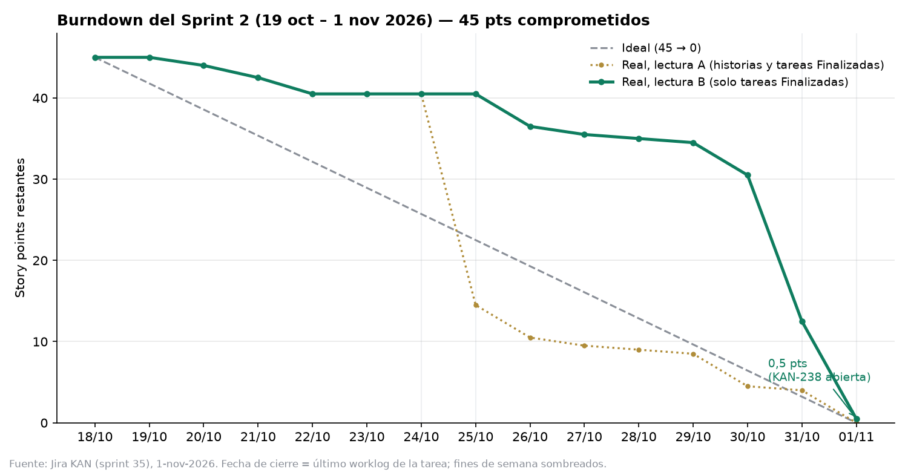
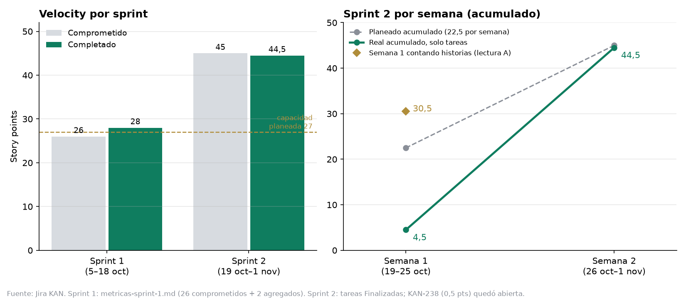
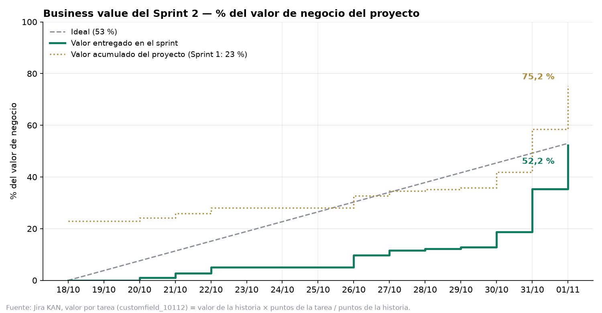

# Métricas del cierre del Sprint 2 — metodología y trazabilidad

Evidencia de cierre: **burndown**, **velocity** y **business value**. El Sprint 2 corre del lunes 19 de octubre al domingo
1 de noviembre de 2026 (14 días; en Jira es `KAN Sprint 2`, id 35). Corte: **2026-11-01, 16:00 hora de Colombia**, el
día del cierre. Reemplaza a la medición parcial de la semana 1 (`metricas-sprint-2-semana-1.md`, corte del 25/10).

Fuente: tablero Jira **KAN**, leído por la API (MCP Atlassian Rovo) el 2026-11-01: puntos (`customfield_10076`), valor de
negocio por historia (`customfield_10111`) y por tarea (`customfield_10112`), estado, fecha de resolución y worklogs de las
42 incidencias del sprint. Los números no son inventados para el gráfico.

## Resultado

| | Comprometido | Completado | |
|---|---|---|---|
| Story points | 45 | **44,5** (solo tareas Finalizadas) · 45 contando historias | 98,9 % |
| Business value | 53 % del proyecto | **52,2 %** | 98,5 % |
| Historias | 4 | 4 «Finalizada» en Jira | HU-W03, HU-W04, HU-W07, HU-M01 |

Lo único abierto es **KAN-238** (HU-M01, 0,5 pts, 0,6 % del valor): «Tareas por hacer» y sin worklog, aunque su historia está
Finalizada. Por eso la lectura de tareas termina en 0,5 y no en 0.

## Alcance

| Historia | Jira | Puntos | Valor | Tareas |
|---|---|---|---|---|
| HU-W03 Suscripción, cobro y emisión de póliza | KAN-26 | 13 | 15 % | KAN-209 a 216, 240 y 241 |
| HU-W04 Siniestros asistidos y peritaje | KAN-27 | 13 | 8 % | KAN-242 a 249 |
| HU-W07 Alta de socios de distribución | KAN-30 | 6 | 15 % | KAN-217 a 224 |
| HU-M01 Onboarding y verificación biométrica | KAN-31 | 13 | 15 % | KAN-231 a 238 |
| **Total** | | **45** | **53 %** | 34 tareas con puntos |

Los puntos de las tareas suman exacto los de su historia, y su valor (`valor de la historia × puntos de la tarea / puntos de
la historia`) también. Quedan fuera, por no tener puntos: KAN-171 y KAN-239 (Frontend, transversales), KAN-230 y KAN-250.
El alcance es el del reajuste del 25/10 (45 pts; ver `release-burndown.md`), sin cambios después.

## Criterio de «hecho» y fecha de cierre

- **Hecho = tarea «Finalizada» en Jira (lectura B).** Es la base del Sprint 1 y la única comparable con él. La **lectura A**
  (historias y tareas Finalizadas) cuenta una historia entera desde el día en que Jira la marcó Finalizada; se dibuja como
  referencia porque en la semana 1 HU-M01 y HU-W04 se cerraron como historia con sus tareas abiertas. Al cierre del sprint
  las dos lecturas casi coinciden: 45 contra 44,5.
- **Fecha de cierre de una tarea = fecha del último worklog** (`started`, hora de Colombia), no la de resolución, como en el
  Sprint 1: las resoluciones se concentran en el 24/10 y el 1/11 (cierre administrativo) y no reflejan cuándo se trabajó.
- **Excepciones (5 tareas), con su fecha de resolución:** el último worklog cae fuera del sprint o no existe.

| Tarea | Último worklog | Se usa |
|---|---|---|
| KAN-231 | 01/10 (antes del sprint) | 31/10 (resolución) |
| KAN-234 | 29/09 (antes del sprint) | 31/10 (resolución) |
| KAN-217 | 04/11 (después del cierre) | 01/11 (resolución) |
| KAN-248 | 03/11 (después del cierre) | 01/11 (resolución) |
| KAN-221 | sin worklog | 01/11 (resolución) |

Las fechas fuera del sprint son errores de registro y conviene corregirlas en Jira; también el worklog de la historia
KAN-30, fechado el 03/11. Los worklogs de las tareas de Frans de HU-W03 (KAN-209, 210, 214, 216, 240 y 241) se registraron
el 01/11 con un reparto declarado (estimado × 0,725, la razón real de sus tareas ya cerradas) sobre los días con commits;
cada uno lo dice en su comentario. Sus fechas mueven el burndown.

## Burndown (`burndown-sprint-2.png`)

Puntos restantes al cierre de cada día. Ideal: 45 → 0 en línea recta. Fines de semana sombreados.

| Fecha | Cerrado ese día (B) | Tareas | Restante A | Restante B |
|---|---|---|---|---|
| Inicio | — | — | 45 | 45 |
| 19/10 | 0 | — | 45 | 45 |
| 20/10 | 1 | KAN-211 | 44 | 44 |
| 21/10 | 1,5 | KAN-213 | 42,5 | 42,5 |
| 22/10 | 2 | KAN-209, 212, 215 | 40,5 | 40,5 |
| 23/10 | 0 | — | 40,5 | 40,5 |
| 24/10 | 0 | — | 40,5 | 40,5 |
| 25/10 | 0 | (HU-M01 y HU-W04 Finalizada como historia) | 14,5 | 40,5 |
| 26/10 | 4 | KAN-240 | 10,5 | 36,5 |
| 27/10 | 1 | KAN-214, 220 | 9,5 | 35,5 |
| 28/10 | 0,5 | KAN-210 | 9 | 35 |
| 29/10 | 0,5 | KAN-216 | 8,5 | 34,5 |
| 30/10 | 4 | KAN-218, 241 | 4,5 | 30,5 |
| 31/10 | 18 | KAN-222, 231, 232, 233, 234, 242, 243, 244, 247 | 4 | 12,5 |
| 01/11 | 12 | KAN-217, 219, 221, 223, 224, 235, 236, 237, 245, 246, 248, 249 | 0 | **0,5** |

**Lectura:** la curva de tareas va por encima de la ideal casi todo el sprint y cae al final: 30 de los 44,5 pts se cierran
el 31/10 y el 1/11. No es que el trabajo se hiciera solo esos dos días (las historias de M01 y W04 tenían su trabajo desde la
semana 1, y su tiempo estaba registrado sobre la historia); es que las tareas se cerraron y registraron tarde. Es la
principal lección de proceso para el Sprint 3: registrar el tiempo en la tarea y cerrarla el día que termina.

Cambios frente a la semana 1 (`metricas-sprint-2-semana-1.md`): la lectura B de la semana 1 pasa de 4 a 4,5 pts (KAN-209 se
cerró el 1/11, pero su último worklog es del 22/10), y la lectura A cuenta HU-M01 y HU-W04 desde su resolución (25/10) en
vez del último worklog de la historia (23 y 24/10), para usar la misma regla con las cuatro historias.

## Velocity (`velocity-sprint-2.png`)

Dos vistas: por sprint (comprometido contra completado) y, dentro del Sprint 2, acumulado por semana con el plan repartido de
forma lineal (22,5 pts por semana), como en el Sprint 1.

| Sprint | Comprometido | Completado | Capacidad planeada |
|---|---|---|---|
| Sprint 1 (5–18 oct) | 26 | 28 (26 + 2 agregados) | 27 |
| Sprint 2 (19 oct–1 nov) | 45 | **44,5** (45 contando historias) | 27 |

| Semana del Sprint 2 | Planeado (acum.) | Real (acum., lectura B) | Real de la semana |
|---|---|---|---|
| 1 (19–25 oct) | 22,5 | 4,5 (30,5 en la lectura A) | 4,5 |
| 2 (26 oct–1 nov) | 45 | 44,5 | 40 |

El Sprint 2 completó 44,5 pts con la capacidad planeada de 27: el reajuste del 25/10 trajo HU-W04 y HU-M01 del Sprint 3 y el
equipo las cerró. La velocity promedio de los dos sprints es **36,3 pts** (28 y 44,5).

## Business value (`value-sprint-2.png`)

Valor entregado = suma del valor de las tareas Finalizadas, en % del valor de negocio del proyecto, por fecha de cierre.

| Historia | Valor de la historia | Entregado |
|---|---|---|
| HU-W03 | 15 % | 15,0 % |
| HU-W07 | 15 % | 15,0 % |
| HU-M01 | 15 % | 14,3 % (falta KAN-238, 0,6 %) |
| HU-W04 | 8 % | 7,9 % (redondeo del valor por tarea) |
| **Sprint 2** | **53 %** | **52,2 %** |

Con el 23 % del Sprint 1 (HU-W01 15 % + HU-W05 8 %), el proyecto lleva **75,2 %** de su valor de negocio entregado. La línea
punteada del gráfico es ese acumulado; la verde, lo del Sprint 2.

## Salvedades

- **Tareas Finalizadas en Jira, no desplegadas.** «Finalizada» es el estado del tablero. Varias piezas de HU-W03 y HU-M01 se
  liberaron en staging el 1/11 (release `sprint-5` del backend) y algunas correcciones siguen en PR (contrato en PDF #484,
  trazo de la firma web #131, Didit #485). Lo que falta de HU-W03 en staging (EC005/EC007, Cloud KMS real) no tiene tarea en
  este sprint.
- **Fechas reconstruidas.** Ver «Excepciones» y el reparto de los worklogs de HU-W03: el burndown muestra cuándo se registró y
  cerró el trabajo, que en este sprint se separa de cuándo se hizo.
- Corte del 1/11 a las 16:00; el sprint cierra esa noche. Si el tablero cambia después, los números también.

## Cómo se generaron las imágenes

`matplotlib` (Python), script ad hoc de la sesión (no versionado): los datos de origen y la metodología están en este archivo
para poder regenerarlas. Paleta verde `#0f7d5f` y dorado `#b08d3a`, la de las gráficas del Sprint 1.
