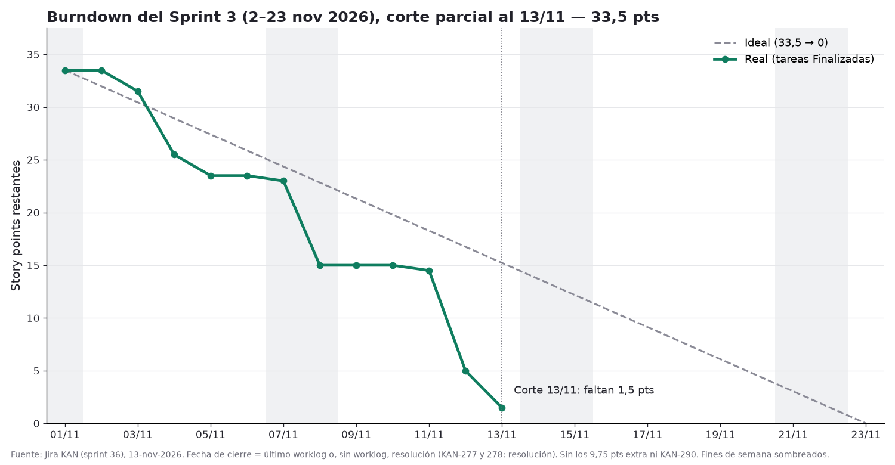
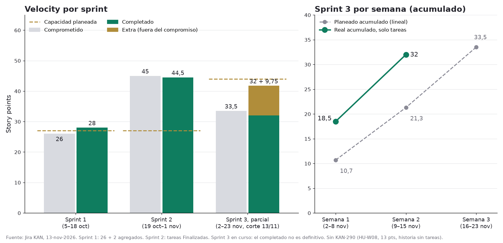
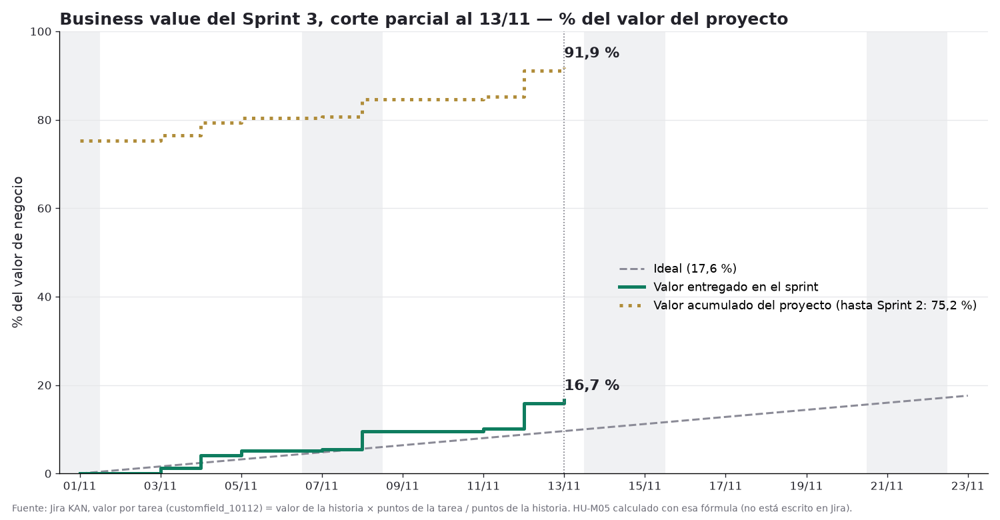

# Métricas del Sprint 3, semana 2 — corte del 13/11 (metodología y trazabilidad)

Evidencia de **burndown**, **velocity** y **business value**. El Sprint 3 corre del lunes 2 al lunes 23 de noviembre de 2026
(`KAN Sprint 3`, id 36; en Jira cierra el 23/11 a las 23:59 hora de Colombia). **Corte: 2026-11-13, hacia las 23:00 hora de
Colombia, sin contar los días 14 y 15 de la semana 2. El sprint sigue en curso: estos números son parciales y cambian.**

Fuente: tablero Jira **KAN**, leído por la API (MCP Atlassian Rovo) el 2026-11-13: puntos (`customfield_10076`), valor por
historia (`customfield_10111`) y por tarea (`customfield_10112`), estado, fecha de resolución y worklogs de las 52
incidencias del sprint. Misma metodología que el corte del 8/11 (`metricas-sprint-3.md`).

## Resultado al corte

| | Comprometido | Completado | |
|---|---:|---:|---:|
| Story points | 33,5 | **32** | 95,5 % |
| Business value | 17,6 % del proyecto | **16,7 %** | 94,8 % |
| Extra, fuera del compromiso | — | 9,75 pts (valor 0 %) | KAN-281 a 287 y KAN-291 a 295 |

El proyecto lleva **91,9 %** de su valor de negocio entregado (75,2 % hasta el Sprint 2 + 16,7 %).

Frente al corte del 8/11 (18,5 pts y 9,5 %): **+13,5 pts y +7,2 puntos de valor**, de HU-M04 (+9,5 pts), HU-M05 (+1,5),
KAN-273 (+2) y KAN-238 (+0,5).

## Alcance

| Historia | Jira | Puntos | Valor | Finalizado | Valor entregado |
|---|---|---:|---:|---:|---:|
| HU-M02 Autenticación biométrica | KAN-32 | 6 | 3 % | 6 | 3 % |
| HU-M04 Siniestro paramétrico | KAN-38 | 13 | 8 % | 11,5 | 7,08 % |
| HU-M05 Reporte de siniestro | KAN-35 | 6 | 3 % | 6 | 3 % |
| HU-M06 Prestadores y asistencia | KAN-36 | 6 | 3 % | 6 | 3 % |
| Arrastre de HU-M01 | KAN-238 | 0,5 | 0,6 % | 0,5 | 0,6 % |
| Transversal: contrato y póliza inmutables | KAN-273 | 2 | 0 % | 2 | 0 % |
| **Total** | | **33,5** | **17,6 %** | **32** | **16,68 %** |

**Faltan 1,5 pts:** KAN-261 (1, k6 de la ráfaga reducida) y KAN-262 (0,5, documentación), ambas de HU-M04 y «En curso».

Fuera de los puntos: KAN-230 (0 pts), las tareas de regresión KAN-269 a 272 (sin puntos, «Por hacer») y KAN-250, KAN-288 y
KAN-289 (sin puntos, Finalizadas). Si la regresión recibe puntos, el comprometido sube.

## Criterio

- **Hecho = tarea «Finalizada» en Jira** (lectura B del Sprint 2). Las historias no suman.
- **Fecha de cierre = último worklog** (`started`). **Sin worklog, la fecha de resolución.**
- **Excepción de este corte:** KAN-277 y KAN-278 usan su fecha de resolución (13/11). Su único worklog, ponderado y no medido,
  arranca el primer día de trabajo (4/11 y 5/11) y no dice cuándo se cerraron.
- **Lo extra (etiquetas `Extra-*`) no entra al burndown ni al value.** En velocity se apila aparte.
- **Ideal:** línea recta de 33,5 a 0 entre el 1/11 (inicio) y el 23/11, en días calendario.

## Burndown (`burndown-sprint-3-semana-2.png`)

| Fecha | Cerrado ese día | Tareas | Restante |
|---|---:|---|---:|
| Inicio | — | — | 33,5 |
| 02/11 | 0 | — | 33,5 |
| 03/11 | 2 | KAN-260 | 31,5 |
| 04/11 | 6 | KAN-226, 274, 275, 276, 279 | 25,5 |
| 05/11 | 2 | KAN-225 | 23,5 |
| 06/11 | 0 | — | 23,5 |
| 07/11 | 0,5 | KAN-229 | 23 |
| 08/11 | 8 | KAN-227, 228, 263 a 268 | **15** |
| 09/11 | 0 | — | 15 |
| 10/11 | 0 | — | 15 |
| 11/11 | 0,5 | KAN-238 | 14,5 |
| 12/11 | 9,5 | KAN-255 a 259 | 5 |
| 13/11 | 3,5 | KAN-273, 277, 278 | **1,5** |

**Lectura:** el 8/11 sigue en 15 pts, igual que en el corte anterior; lo que cambia es la forma entre el 4 y el 8. Las
tareas de HU-M05 KAN-274, 275, 276 y 279 (4,5 pts) tenían fecha de resolución del 8/11 y ahora llevan worklog del 4/11, que
es cuando se hizo su código. Esos worklogs son ponderados, no medidos (cada uno lo dice en su comentario). La caída más
grande es la del 12/11: 9,5 pts de HU-M04 en un día.

## Velocity (`velocity-sprint-3-semana-2.png`)

| Sprint | Comprometido | Completado | Capacidad planeada |
|---|---:|---:|---:|
| Sprint 1 (5–18 oct) | 26 | 28 (26 + 2 agregados) | 27 |
| Sprint 2 (19 oct–1 nov) | 45 | 44,5 | 27 |
| Sprint 3 (2–23 nov), **parcial** | 33,5 | **32** + 9,75 extra | 44 |

| Semana del Sprint 3 | Planeado (acum.) | Real (acum.) |
|---|---:|---:|
| 1 (2–8 nov) | 10,7 | 18,5 |
| 2 (9–15 nov), parcial al 13/11 | 21,3 | **32** |
| 3 (16–23 nov) | 33,5 | — |

No se calcula la velocity promedio con el Sprint 3: todavía no ha cerrado.

## Business value (`value-sprint-3-semana-2.png`)

| Fecha | Valor acumulado del sprint | Acumulado del proyecto |
|---|---:|---:|
| 03/11 | 1,23 % | 76,4 % |
| 04/11 | 4,18 % | 79,4 % |
| 05/11 | 5,18 % | 80,4 % |
| 07/11 | 5,48 % | 80,7 % |
| 08/11 | 9,48 % | 84,7 % |
| 11/11 | 10,08 % | 85,3 % |
| 12/11 | 15,93 % | 91,1 % |
| 13/11 | 16,68 % | **91,9 %** |

Las tareas de HU-M05 siguen con el campo de valor vacío. Aquí se calcula con la fórmula del equipo (3 % × puntos de la tarea /
6): 3 % por sus 6 pts. **Ese valor no se escribió en Jira.**

## Salvedades

- **KAN-290 (HU-W08, 13 pts) no está en los números.** Es una historia creada el 10/11, agregada al sprint después del
  compromiso de 33,5, sin tareas, sin worklogs y sin valor en Jira, y pasó a Finalizada el 13/11 por la noche. La regla
  «hecho = tarea Finalizada» la deja fuera. Tiene respaldo en código: el backend del 10/11 (RISK, RATING, POLICY, CLAIMS, BFF,
  ACL, Newman) y el móvil. **Si el equipo la cuenta como trabajo agregado, el completado extra sube de 9,75 a 22,75 pts** y el
  valor no cambia, porque no tiene valor asignado. Es una decisión del equipo.
- **HU-M04 cerró 9,5 pts en un día (KAN-255 a 259), el 12/11 por sus worklogs.** Esas tareas llevan worklogs de 1 h (KAN-255
  a 258) y de 8 h (KAN-259). El código de la historia está en el repo pero bajo la clave KAN-259 (fases 2 a 7: push por SNS,
  ingesta paramétrica, liquidación automática, Terraform, móvil); no hay commits con las claves KAN-255 a 258. Sigue abierta
  la medición k6 de la ráfaga reducida (KAN-261).
- **KAN-278 se cerró con una deuda conocida.** El `integration_test` de M05 falla en 3 pruebas del flujo Emuladores de
  `develop` móvil desde el PR #96 (la ciudad ahora se elige de una lista y el test sigue escribiendo «Bogotá» en un campo de
  texto). Es un problema de la prueba, no de la app. Queda anotado en el comentario de KAN-278.
- **KAN-35 se cerró con brechas contra el texto de la historia:** el GPS viaja como dato de cada evidencia y no incrustado en el
  EXIF (W04-14), no hay escaneo de facturas y falta verificar en staging.
- **KAN-273 (2 pts, valor 0 %) no tiene worklog**; su fecha es la de resolución (13/11).
- **«Finalizada» no es «en staging».** Lo móvil de M02, M05 y M06 y el backend de M04 no están medidos en staging.
- **Los extra se reconocen con fecha posterior:** KAN-291 a 295 (5,25 pts, extras de HU-M06) se crearon en Jira el 13/11 para
  trabajo del 12 y el 13/11.
- **El corte es del viernes por la noche:** quedan el sábado y el domingo de la semana 2 y toda la semana 3. El burndown va por
  debajo de la ideal, pero la regresión (KAN-269 a 272) no tiene puntos y no está en esa curva.

## Cómo se generaron las imágenes

`matplotlib` (Python), script ad hoc de la sesión (no versionado): los datos de origen y la metodología están en este archivo
para poder regenerarlas. Paleta verde `#0f7d5f` y dorado `#b08d3a`, la de las gráficas anteriores.
