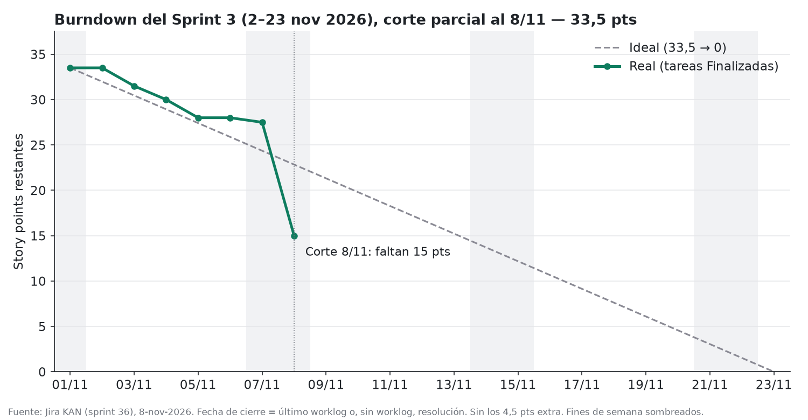
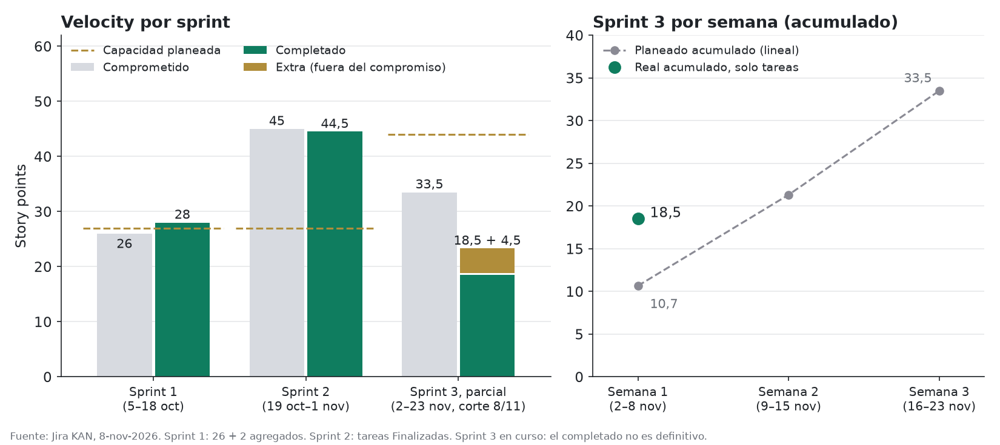
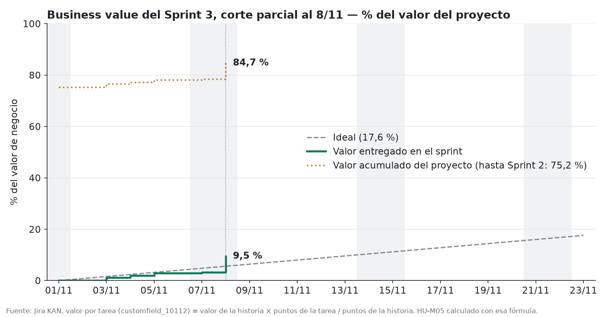

# Métricas del Sprint 3 — corte parcial del 8/11 (metodología y trazabilidad)

Evidencia de **burndown**, **velocity** y **business value**. El Sprint 3 corre del lunes 2 al lunes 23 de noviembre de 2026
(`KAN Sprint 3`, id 36; en Jira cierra el 23/11 a las 23:59 hora de Colombia). **Corte: 2026-11-08, 16:10 hora de Colombia.
El sprint sigue en curso: estos números son parciales y cambian.**

Fuente: tablero Jira **KAN**, leído por la API (MCP Atlassian Rovo) el 2026-11-08: puntos (`customfield_10076`), valor por
historia (`customfield_10111`) y por tarea (`customfield_10112`), estado, fecha de resolución y worklogs de las 46
incidencias del sprint.

## Resultado al corte

| | Comprometido | Completado | |
|---|---:|---:|---:|
| Story points | 33,5 | **18,5** | 55,2 % |
| Business value | 17,6 % del proyecto | **9,5 %** | 53,9 % |
| Extra, fuera del compromiso | — | 4,5 pts (valor 0 %) | KAN-281 a KAN-287 |

El proyecto lleva **84,7 %** de su valor de negocio entregado (75,2 % hasta el Sprint 2 + 9,5 %).

## Alcance

| Historia | Jira | Puntos | Valor | Finalizado |
|---|---|---:|---:|---:|
| HU-M02 Autenticación biométrica | KAN-32 | 6 | 3 % | 6 |
| HU-M04 Siniestro paramétrico | KAN-38 | 13 | 8 % | 2 |
| HU-M05 Reporte de siniestro | KAN-35 | 6 | 3 % | 4,5 |
| HU-M06 Prestadores y asistencia | KAN-36 | 6 | 3 % | 6 |
| Arrastre de HU-M01 | KAN-238 | 0,5 | 0,6 % | 0 |
| Transversal: contrato y póliza inmutables | KAN-273 | 2 | 0 % | 0 |
| **Total** | | **33,5** | **17,6 %** | **18,5** |

**Faltan 15 pts:** KAN-255 a 259, 261 y 262 (HU-M04, 11 pts), KAN-273 (2), KAN-277 (1), KAN-238 (0,5) y KAN-278 (0,5).

Fuera de los puntos: KAN-230 (0 pts) y las tareas sin puntos KAN-250, KAN-269 a 272, KAN-288 y KAN-289. Si la regresión
(KAN-269 a 272) recibe puntos, el comprometido sube.

## Criterio

- **Hecho = tarea «Finalizada» en Jira** (lectura B del Sprint 2). Las historias y las pantallas no suman.
- **Fecha de cierre = último worklog** (`started`). **Sin worklog, la fecha de resolución.**
- **Lo extra (etiquetas `Extra-*`) no entra al burndown ni al value.** En velocity se apila aparte. Esas tareas están en el
  sprint de Jira, así que un burndown generado por el propio Jira sí las contaría.
- **Ideal:** línea recta de 33,5 a 0 entre el 1/11 (inicio) y el 23/11, en días calendario.

## Burndown (`burndown-sprint-3.png`)

| Fecha | Cerrado ese día | Tareas | Restante |
|---|---:|---|---:|
| Inicio | — | — | 33,5 |
| 02/11 | 0 | — | 33,5 |
| 03/11 | 2 | KAN-260 | 31,5 |
| 04/11 | 1,5 | KAN-226 | 30 |
| 05/11 | 2 | KAN-225 | 28 |
| 06/11 | 0 | — | 28 |
| 07/11 | 0,5 | KAN-229 | 27,5 |
| 08/11 | 12,5 | KAN-227, 228, 263 a 268, 274, 275, 276, 279 | **15** |

**Lectura:** 12,5 de los 18,5 pts caen el 8/11, y 12 de ellos son de 11 tareas **sin worklog** (KAN-227, 263 a 268, 274 a
276 y 279), que toman su fecha de resolución. No es que se hicieran ese día: el código de M05 y M06 se integró entre el 4 y
el 8/11. Con sus worklogs, la curva se reparte y se acerca más a la ideal.

## Velocity (`velocity-sprint-3.png`)

| Sprint | Comprometido | Completado | Capacidad planeada |
|---|---:|---:|---:|
| Sprint 1 (5–18 oct) | 26 | 28 (26 + 2 agregados) | 27 |
| Sprint 2 (19 oct–1 nov) | 45 | 44,5 | 27 |
| Sprint 3 (2–23 nov), **parcial** | 33,5 | **18,5** + 4,5 extra | 44 |

| Semana del Sprint 3 | Planeado (acum.) | Real (acum.) |
|---|---:|---:|
| 1 (2–8 nov) | 10,7 | 18,5 |
| 2 (9–15 nov) | 21,3 | — |
| 3 (16–23 nov) | 33,5 | — |

No se calcula la velocity promedio con el Sprint 3: todavía no ha cerrado.

## Business value (`value-sprint-3.png`)

| Fecha | Valor acumulado del sprint | Acumulado del proyecto |
|---|---:|---:|
| 03/11 | 1,23 % | 76,4 % |
| 04/11 | 1,93 % | 77,1 % |
| 05/11 | 2,93 % | 78,1 % |
| 07/11 | 3,23 % | 78,4 % |
| 08/11 | 9,48 % | **84,7 %** |

Las tareas de HU-M05 tienen vacío el campo de valor. Aquí se calcula con la fórmula del equipo (3 % × puntos de la tarea / 6):
2,25 % por sus 4,5 pts. **Ese valor no se escribió en Jira.**

## Salvedades

- **Parcial.** Quedan 15 días de sprint. El avance adelantado frente a la ideal no significa que el sprint vaya a cerrar:
  HU-M04 (11 de los 15 pts pendientes) casi no tiene código y su backend no existe.
- **KAN-260 (2 pts, 1,23 %) está Finalizada con datos simulados.** Sus pantallas no tienen contrato ni navegación, y falta
  M04-01 (móvil #59). Su worklog es del 3/11, antes de ese PR, que es del 8/11. Si se reabre, el total baja a 16,5 pts y 8,25 %.
- **KAN-228 (0,5 pts) está Finalizada.** Su título pide dispositivo físico y Firebase Test Lab; la evidencia en el repo es de
  un emulador con biometría real.
- **«Finalizada» no es «en staging».** Lo móvil de M02, M05 y M06 no ha llegado a `main`.
- **`develop` móvil tiene Emuladores en rojo** (Tablet API 34, prueba intermitente de M05). El arreglo está en el PR móvil
  #62, en verde en su rama y sin integrar.
- **Los extra se reconocen con fecha posterior:** son trabajo del 31/10 al 6/11, creado en Jira el 8/11.

## Cómo se generaron las imágenes

`matplotlib` (Python), script ad hoc de la sesión (no versionado): los datos de origen y la metodología están en este archivo
para poder regenerarlas. Paleta verde `#0f7d5f` y dorado `#b08d3a`, la de las gráficas anteriores.
