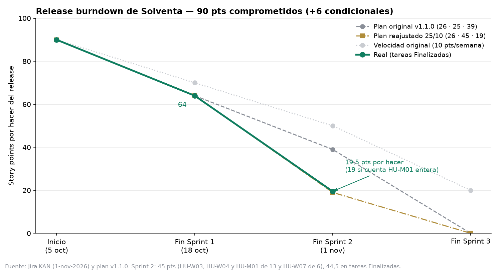

# Release burndown — metodología y trazabilidad

Fuentes: tablero **Jira KAN** (puntos y estado de cada historia, leídos por la API de Jira vía MCP Atlassian Rovo el
2026-10-19, el 2026-10-25, tras el reajuste, y el **2026-11-01, al cierre del Sprint 2**) y el **plan de trabajo v1.1.0** (`solventa-arquitectura/utils/Solventa Plan
de Trabajo y Historias de Usuario del Sprint 1 - Proyecto Final 2 (versión 1.1.0).docx`: asignación de historias a sprints,
secciones 1.1 y 1.3, y capacidad). Los números no son inventados para el gráfico.

## Qué mide

Los **puntos de historia que le faltan al release** al cierre de cada sprint. El release son las 9 historias del alcance del
plan (**96 pts**): 8 comprometidas (**90 pts**) y HU-M06 (6 pts), que queda *condicional*. «Pendiente» es lo comprometido que
todavía no está finalizado. **El alcance del release no cambió con el reajuste del 25/10: cambió en qué sprint cae cada historia.**

## Cómo se calculó

| Serie | Valores | De dónde sale |
|---|---|---|
| **Plan original** (plan v1.1.0, gráfico del 19/10) | 90 → 64 → 39 → 0 | Compromiso del plan por sprint: 26, 25 y 39 pts (capacidad 27, 27 y 44) |
| **Plan reajustado** (25/10) | 90 → 64 → **19** → 0 | Compromiso reajustado por sprint: 26, **45** y **19** pts (misma capacidad 27, 27 y 44). Detalle en «Reajuste del 25/10/2026» |
| **Real** | 90 → 64 (fin del Sprint 1) → **19,5** (fin del Sprint 2; 19 contando historias) | Sprint 1: HU-W01 (KAN-24, 20 pts) y HU-W05 (KAN-28, 6 pts) «Finalizada» el 2026-10-18. Sprint 2: las cuatro historias (HU-W03, HU-W04 y HU-M01 de 13 pts y HU-W07 de 6) «Finalizada» en Jira; en tareas, 44,5 de 45 pts, porque KAN-238 (HU-M01, 0,5 pts) quedó «Tareas por hacer». Criterio y detalle en `metricas-sprint-2.md` |
| **Velocidad original** | 90 → 70 → 50 → 20 | 10 pts por semana (documento de arquitectura) aplicados a las semanas 2, 4 y 7 del release: lo que faltaría si no se hubiera recalculado |

- Los **2 pts agregados** durante el Sprint 1 (KAN-207 y KAN-208, sin historia padre) no pertenecen al alcance del release: se
  sumaron y se completaron dentro del sprint, así que no cambian lo que resta. El burndown del sprint
  (`burndown.png`, ver `metricas-sprint-1.md`) sí los cuenta como alcance agregado.
- **El Sprint 3 es el plan, no una proyección con la velocidad real.** La línea verde termina donde termina lo medido: el cierre
  del Sprint 2 (1/11). La medición parcial del 25/10 (34 contando historias, 60 solo tareas) queda en el historial de git.
- La capacidad del plan es de **98 pts** (27 + 27 + 44) y no cambió. Mantener 10 pts por semana durante 7 semanas daría solo 70,
  que no alcanza para los 90 comprometidos: es la razón del recálculo del plan.

## Reajuste del 25/10/2026 y su justificación

El equipo reajustó el Sprint 2 y el Sprint 3. Cada cambio, con lo que había y lo que hay:

| Historia | Antes (plan v1.1.0) | Ahora (25/10) | Por qué |
|---|---|---|---|
| **HU-W03** (KAN-26) | 6 pts, Sprint 2 | **13 pts**, Sprint 2, dura todo el sprint | La estimación se quedó corta. Las 8 tareas de Jira (KAN-209 a 216, 6 pts) cubren los bloques 1 a 6 de `docs/plan-completar-hu-w03.md`. Después el alcance real sumó el **bloque 7** (brechas contra los criterios oficiales: la firma sin 5xx por el gateway, la versión de reglas y la oferta preliminar, la reapertura de una póliza con el pago recuperado, el cifrado de POLICY con sus logs, `motivoEstado`, `oferta(id)`) y el **bloque 8** (el PDF adjunto al aviso, con el contacto del cliente como dato personal nuevo cifrado en AUTH, la dependencia nueva de `policy` hacia `auth` y su evidencia EC022). Se registran como **KAN-240 (4 pts)** y **KAN-241 (3 pts)**: +7 pts. Las 8 tareas originales conservan sus 6 pts, así que lo ya finalizado no se reestima |
| **HU-W07** (KAN-30) | 13 pts, Sprint 2 | **6 pts**, Sprint 2, **arranca en la 2.ª semana** | Corrección de la estimación por el equipo: la historia no era de 13 pts sino de 6. Las 8 tareas (KAN-217 a 224) se rebalancearon proporcionalmente (× 6/13, a pasos de 0,25 pts). Pasa a 6 pts: −7 pts |
| **HU-M01** (KAN-31) | 13 pts, «2 y 3», se contaba en el Sprint 3 | 13 pts, **cierra en el Sprint 2** | Empezó en la 1.ª semana del Sprint 2 y se cierra dentro de él. Sus 13 pts pasan a contarse en el Sprint 2 |
| **HU-W04** (KAN-27) | 13 pts, Sprint 3 | 13 pts, **Sprint 2** | El equipo la trajo del Sprint 3. Sus 8 tareas del plan (T-W04-1 a 8, 25 h) quedan en Jira como **KAN-242 a 249**, sin asignar, con 13 pts repartidos según las horas del plan |
| **HU-M02** (KAN-32) | 6 pts, Sprint 2 | 6 pts, **Sprint 3** | Decisión del equipo. Contexto en Jira: no tiene responsable, depende del esqueleto de la app móvil (KAN-171, todavía «Tareas por hacer») y se enlaza con el final de HU-M01. Se sacó del Sprint 2 (KAN-32 y KAN-225 a 229) |

Cuentas del reajuste:

| | Plan original (v1.1.0) | Plan reajustado (25/10) | Cambio |
|---|---|---|---|
| **Sprint 1** | 26 (real: 26 + 2 agregados) | 26 | — |
| **Sprint 2** | HU-W07 13 + HU-W03 6 + HU-M02 6 = **25** | HU-W03 13 + HU-M01 13 + HU-W04 13 + HU-W07 6 = **45** | +20 (+7 W03, −7 W07, −6 M02, +13 M01, +13 W04) |
| **Sprint 3** | HU-M01 13 + HU-W04 13 + HU-M04 13 = **39** (+6 HU-M06 cond.) | HU-M04 13 + HU-M02 6 = **19** (+6 HU-M06 cond.) | −20 |
| **Comprometido del release** | 90 | 90 | 0 (W03 +7 compensa W07 −7) |
| **Pendiente al cierre del Sprint 2** | 39 | **19** | −20 |

### Qué riesgo traía y cómo terminó

**Resultado (1/11):** el Sprint 2 cerró **44,5 de 45 pts** en tareas (las cuatro historias «Finalizada»): no se desbordó nada al
Sprint 3, que queda con su plan de 19 pts (+6 de HU-M06). El riesgo se cumplió en otra forma: 30 de los 44,5 pts se cerraron en los
dos últimos días (ver `metricas-sprint-2.md`). El análisis de riesgo del 25/10 se deja como estaba:

- **El Sprint 2 queda en 45 pts frente a una capacidad de 27 (167 %, 18 pts por encima).** El Sprint 1 rindió 26 (28 con lo
  agregado); el Sprint 2 pide 1,7 veces eso. Al corte del 25/10 (mitad del sprint) hay **30 de 45 pts finalizados** (solo 4 si se cuentan únicamente tareas: 26 salen de dos
  historias cerradas el mismo día con tareas abiertas). Si no se cumple lo que falta,
  lo que se desborde cae en el Sprint 3, que queda con **25 pts de holgura** (19 de 44): ahí hay lugar para absorberlo y para
  HU-M06 (6 pts). El reajuste mueve el riesgo de plazo del Sprint 3 al Sprint 2; el plan total no se alarga.
- **La capacidad del Sprint 2 no se tocó (27).** Si el equipo la cambió, hay que decirlo y reponer el cálculo: la justificación
  descansa en que la capacidad es la misma.
- **HU-M06 deja de ser condicional por capacidad** (el Sprint 3 la absorbe con holgura), pero seguirá figurando como condicional
  en el gráfico hasta que el equipo la confirme.

## Historias del release

| Historia | Jira | Puntos | Sprint del plan reajustado | Estado en Jira (1/11) |
|---|---|---|---|---|
| HU-W01 Perfilamiento y oferta de Vida Hipotecario | KAN-24 | 20 | 1 | Finalizada (2026-10-18) |
| HU-W05 Recaudo y pago de indemnizaciones | KAN-28 | 6 | 1 | Finalizada (2026-10-18) |
| HU-W03 Suscripción, cobro y emisión automática de póliza | KAN-26 | **13** (antes 6) | 2 (todo el sprint) | Finalizada (1/11), con sus 10 tareas |
| HU-W07 Alta de socios de distribución e integración | KAN-30 | **6** (antes 13) | 2 (desde la 2.ª semana) | Finalizada (1/11), con sus 8 tareas |
| HU-M01 Onboarding y verificación biométrica | KAN-31 | 13 | **2** (antes 3) | Finalizada (25/10); 7 de 8 tareas (KAN-238 abierta) |
| HU-W04 Operación de siniestros asistidos y peritaje | KAN-27 | 13 | **2** (antes 3) | Finalizada (25/10), con sus 8 tareas (1/11) |
| HU-M04 Procesamiento de siniestro paramétrico automático | KAN-38 | 13 | 3 | Tareas por hacer |
| HU-M02 Autenticación biométrica nativa | KAN-32 | 6 | **3** (antes 2) | Tareas por hacer (fuera del Sprint 2) |
| HU-M06 Geolocalización de prestadores | KAN-36 | 6 | 3 (condicional) | Tareas por hacer |
| **Total del release** | | **96** | | **90 comprometidos + 6 condicionales** |

Fuera del release (backlog futuro, 31 pts): HU-W02 (KAN-25, 6), HU-W06 (KAN-29, 6), HU-M03 (KAN-33, 13) y HU-M05 (KAN-35, 6). Con
ellas, las 13 historias con puntos del backlog suman 127.

Compromiso frente a capacidad: Sprint 1, 26 de 27; **Sprint 2, 45 de 27**; **Sprint 3, 19 de 44** (más HU-M06, 6 pts,
condicional).

## Los 5 hitos del gráfico

1. **Alcance:** 96 pts en 9 historias; 90 comprometidos y HU-M06 condicional. HU-W03 sube de 6 a 13 y HU-W07 baja de 13 a 6: se compensan.
2. **Sprint 1 cerrado (18/10):** HU-W01 y HU-W05 finalizadas, 26 de 27 pts, y 2 pts agregados y completados. Quedan 64.
3. **Reajuste del 25/10:** HU-W03 pasa a 13 pts y dura todo el sprint; HU-W07 baja a 6 y arranca en la 2.ª semana; HU-M02 pasa al
   Sprint 3; HU-M01 cierra en el Sprint 2; HU-W04 se adelanta del Sprint 3.
4. **Sprint 2 cerrado (1/11):** HU-W03, HU-M01, HU-W04 (13 pts cada una) y HU-W07 (6) finalizadas: 44,5 de 45 pts en tareas, con
   capacidad 27. Quedan **19,5** (19 contando HU-M01 entera), sobre el plan reajustado.
5. **Sprint 3 reajustado:** HU-M04 (13) y HU-M02 (6) = 19 pts con capacidad 44, más los 0,5 de KAN-238. Sobran 25 pts: cabe HU-M06 (6).

(Los gráficos anteriores, del 19/10 y del 25/10, tenían otros hitos: siguen en el historial de git, commit `0421195` y siguientes.)

## Salvedades

- **Sprint 1 y Sprint 2 son reales; el Sprint 3 es el plan.**
- **«Finalizada» en Jira no es «en staging».** Parte de HU-W03 y HU-M01 llegó a staging el 1/11 (release `sprint-5` del backend) y
  quedan correcciones en PR; lo que falta medir en staging de HU-W03 (EC005/EC007, Cloud KMS real) no tiene tarea todavía.
- **KAN-238 (HU-M01, 0,5 pts) sigue «Tareas por hacer»** aunque su historia está Finalizada: es la diferencia entre 19 y 19,5.
- **Reparto de HU-W07 por redondeo.** Al escalar × 6/13 la tarea del portal técnico del socio (KAN-222) pasó de 2 a 0,5 pts, el
  recorte relativo más grande. Si el alcance de HU-W07 bajó por otra razón (por ejemplo, salió una tarea), conviene repartir de nuevo.
- **El desglose en puntos de HU-W04** (KAN-242 a 249, según las horas del plan, 25 h → 13 pts) fue una propuesta del 25/10; el
  equipo la usó tal cual.
- **Fechas.** El Sprint 2 en Jira corre del 19 de octubre al 1 de noviembre, con cierre a las 23:59 hora de Bogotá. No se cargaron
  fechas de inicio y fin por historia; «HU-W07 arranca en la 2.ª semana» y «HU-W03 dura todo el sprint» quedan escritas aquí, no en Jira.
- **Estimación en horas.** Las tareas llevan 8,7 h por punto (razón real del Sprint 1). Las reestimadas y las nuevas se calcularon
  con esa razón y su estimación de Jira se actualizó con ella; no coincide con las horas originales del plan de trabajo (25 h para
  HU-W04).
- Los puntos son los del campo *Story Points* de la historia en Jira (`customfield_10076`); al 1/11 coinciden con la suma de sus
  tareas en las cuatro historias del Sprint 2 (HU-W03 13, HU-M01 13, HU-W04 13 y HU-W07 6).
- El estado de HU-W01 y HU-W05 pasó a «Finalizada» en Jira el 2026-10-18; la primera versión de `metricas-sprint-1.md` los
  encontró todavía en «Tareas por hacer».

## Cómo se generó

`matplotlib` (Python), script ad hoc de la sesión (no versionado); los datos de origen y la metodología están en este archivo
para poder regenerarlo. Misma paleta que los demás gráficos del sprint (verde `#0f7d5f` y dorado `#b08d3a`). Regenerado el
2026-11-01 con el cierre del Sprint 2.
