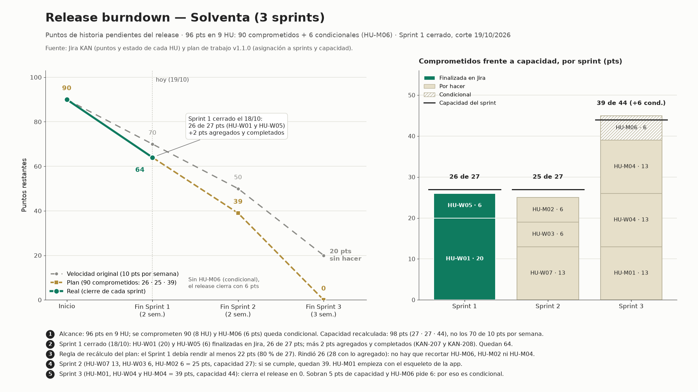

# Release burndown — metodología y trazabilidad

Fuentes: tablero **Jira KAN** (puntos y estado de cada historia, leídos por la API de Jira vía MCP Atlassian Rovo el
2026-10-19) y el **plan de trabajo v1.1.0** (`solventa-arquitectura/utils/Solventa Plan de Trabajo y Historias de Usuario del
Sprint 1 - Proyecto Final 2 (versión 1.1.0).docx`: asignación de historias a sprints, secciones 1.1 y 1.3, y capacidad).
Los números no son inventados para el gráfico.

## Qué mide

Los **puntos de historia que le faltan al release** al cierre de cada sprint. El release son las 9 historias del alcance del
plan (**96 pts**): 8 comprometidas (**90 pts**) y HU-M06 (6 pts), que queda *condicional* por la holgura corta del Sprint 3.
«Pendiente» es lo comprometido que todavía no está finalizado.

## Cómo se calculó

| Serie | Valores | De dónde sale |
|---|---|---|
| **Plan** | 90 → 64 → 39 → 0 | Compromiso del plan por sprint: 26, 25 y 39 pts (capacidad 27, 27 y 44) |
| **Real** | 90 → 64 (fin del Sprint 1) | HU-W01 (KAN-24, 20 pts) y HU-W05 (KAN-28, 6 pts) están «Finalizada» en Jira, con fecha de resolución 2026-10-18 |
| **Velocidad original** | 90 → 70 → 50 → 20 | 10 pts por semana (documento de arquitectura) aplicados a las semanas 2, 4 y 7 del release: lo que faltaría si no se hubiera recalculado |

- Los **2 pts agregados** durante el Sprint 1 (KAN-207 y KAN-208, sin historia padre) no pertenecen al alcance del release: se
  sumaron y se completaron dentro del sprint, así que no cambian lo que resta. El burndown del sprint
  (`burndown.png`, ver `metricas-sprint-1.md`) sí los cuenta como alcance agregado.
- **Sprint 2 y Sprint 3 son el plan, no una proyección con la velocidad real**: todavía no ocurren. La línea verde (real) termina
  donde termina lo medido.
- La capacidad del plan es de **98 pts** (27 + 27 + 44). Mantener 10 pts por semana durante 7 semanas daría solo 70, que no alcanza
  para los 90 comprometidos: es la razón del recálculo.

## Historias del release

| Historia | Jira | Puntos | Sprint del plan | Estado en Jira |
|---|---|---|---|---|
| HU-W01 Perfilamiento y oferta de Vida Hipotecario | KAN-24 | 20 | 1 | Finalizada (2026-10-18) |
| HU-W05 Recaudo y pago de indemnizaciones | KAN-28 | 6 | 1 | Finalizada (2026-10-18) |
| HU-W07 Alta de socios de distribución e integración | KAN-30 | 13 | 2 | Tareas por hacer |
| HU-W03 Suscripción, cobro y emisión automática de póliza | KAN-26 | 6 | 2 | Tareas por hacer |
| HU-M02 Autenticación biométrica nativa | KAN-32 | 6 | 2 | Tareas por hacer |
| HU-M01 Onboarding y verificación biométrica | KAN-31 | 13 | 2 y 3 (se cuenta en el 3) | Tareas por hacer |
| HU-W04 Operación de siniestros asistidos y peritaje | KAN-27 | 13 | 3 | Tareas por hacer |
| HU-M04 Procesamiento de siniestro paramétrico automático | KAN-38 | 13 | 3 | Tareas por hacer |
| HU-M06 Geolocalización de prestadores | KAN-36 | 6 | 3 (condicional) | Tareas por hacer |
| **Total del release** | | **96** | | **90 comprometidos + 6 condicionales** |

Fuera del release (backlog futuro, 31 pts): HU-W02 (KAN-25, 6), HU-W06 (KAN-29, 6), HU-M03 (KAN-33, 13) y HU-M05 (KAN-35, 6). Con
ellas, las 13 historias con puntos del backlog suman 127.

Compromiso frente a capacidad: Sprint 1, 26 de 27; Sprint 2, 25 de 27; Sprint 3, 39 de 44 (más HU-M06, 6 pts, condicional).

## Los 5 hitos del gráfico

1. **Alcance:** 96 pts en 9 historias; 90 comprometidos y HU-M06 condicional. Capacidad recalculada de 98 pts.
2. **Sprint 1 cerrado (18/10):** HU-W01 y HU-W05 finalizadas, 26 de 27 pts, y 2 pts agregados y completados. Quedan 64.
3. **Regla de recálculo del plan:** el Sprint 1 debía rendir al menos 22 pts (80 % de 27) para no recortar. Rindió 26 (28 con
   lo agregado), así que no se recorta HU-M06, HU-M02 ni HU-M04.
4. **Sprint 2:** HU-W07 (13), HU-W03 (6) y HU-M02 (6), 25 pts con capacidad 27. HU-M01 empieza con el esqueleto de la app.
5. **Sprint 3:** HU-M01, HU-W04 y HU-M04, 39 pts con capacidad 44. Sobran 5 pts de capacidad y HU-M06 pide 6: por eso es condicional.

## Salvedades

- **Solo el Sprint 1 es real.** Los otros dos sprints son el plan; hasta que se cierren, no hay velocidad real que contrastar.
- **Fechas.** El Sprint 1 en Jira corrió del 5 al 18 de octubre; el plan lo ubicaba, de forma tentativa, del 12 al 25. Por eso el
  eje del gráfico es por sprint y no por fecha.
- Los puntos son los del campo *Story Points* de la historia en Jira (`customfield_10076`), no la suma de sus tareas.
- El estado de HU-W01 y HU-W05 pasó a «Finalizada» en Jira el 2026-10-18; la primera versión de `metricas-sprint-1.md` los
  encontró todavía en «Tareas por hacer».

## Cómo se generó

`matplotlib` (Python), script ad hoc de la sesión (no versionado); los datos de origen y la metodología están en este archivo
para poder regenerarlo. Misma paleta que los demás gráficos del sprint (verde `#0f7b5f` y dorado `#b08d3a`).
